# FileOrganizer

A Windows desktop organizer that uses AI Hub Universal or manual rules to create a reviewable filing plan, then records every applied action for recovery and undo.

**Status:** local version 0.3.0, with isolated-fixture tests and real application-generated client-area screenshots. The screens below are rendered by the executable's CPU backend using demonstration data, without opening a window or accessing user folders. Native input, window lifecycle and idle/minimized load measurements remain pending. The planned [public repository](https://github.com/siarheisinelnikau/file-organizer) and releases have not been published by this session.

## What it does

- AI Hub Universal categorization into subject/project subfolders, with optional filename suggestions, reasons and confidence-based review. Manual rules remain available.

- Visual, ordered rules with an enable switch and first-match behavior.
- Conditions for case-insensitive filename globs, extensions, relative source subfolders, byte size and age since last modification.
- Move, copy or rename, with filename tokens `{name}`, `{stem}` and `{ext}`.
- Downloads/archives, photos and documents templates, with destinations chosen by you.
- Dry-run plans with individual selection. Conflicts either skip the name or keep both using numbered names. Nothing silently overwrites an existing file.
- Folder monitoring with debouncing and two unchanged observations before a file becomes eligible. Automatic application requires an explicit opt-in; every application launch starts paused.
- Persistent SQLite activity journal, SHA-256 checks, conservative crash recovery and per-operation undo.
- Preservation of Windows creation/access/modification times and basic file attributes during copy/move/rename and journal-based undo.
- Installed version, manual update checks, optional startup checks enabled by default, and a user-initiated download/verify/install/restart flow for future compatible public releases.

FileOrganizer is an independent MIT-licensed implementation. [File Juggler](https://www.filejuggler.com/) is a reference for the general user problem; no competitor code, assets or interface have been copied. There is no affiliation.

## How it works

Use **How it works** on Review or in the sidebar to explore example files and their proposed destinations. Play/Pause, Reset, chapter buttons and a draggable timeline show settings, review, Move/Copy and Undo. Switch between rules and AI or change the example confidence threshold to see the result. The walkthrough never changes your files/settings or contacts a model. [Walkthrough details](docs/GUIDE.md).

## Application screens

Real CPU-rendered client areas at 1160 × 820, 100% scale, with demonstration paths and files. These images verify the app's layout; they do not show OS chrome or certify native input/performance.

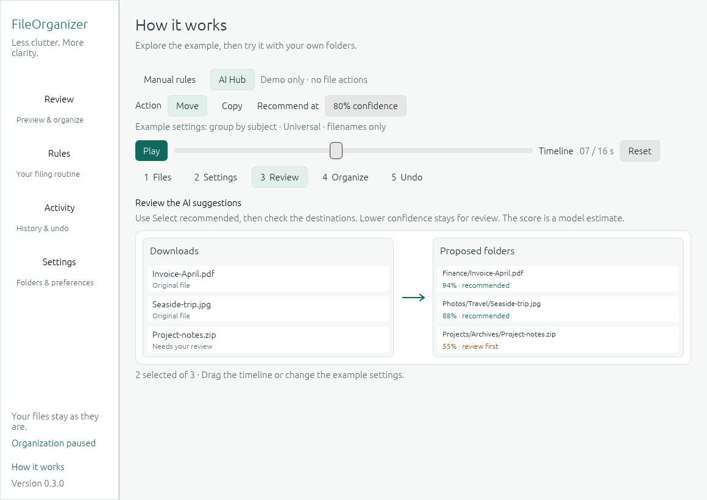

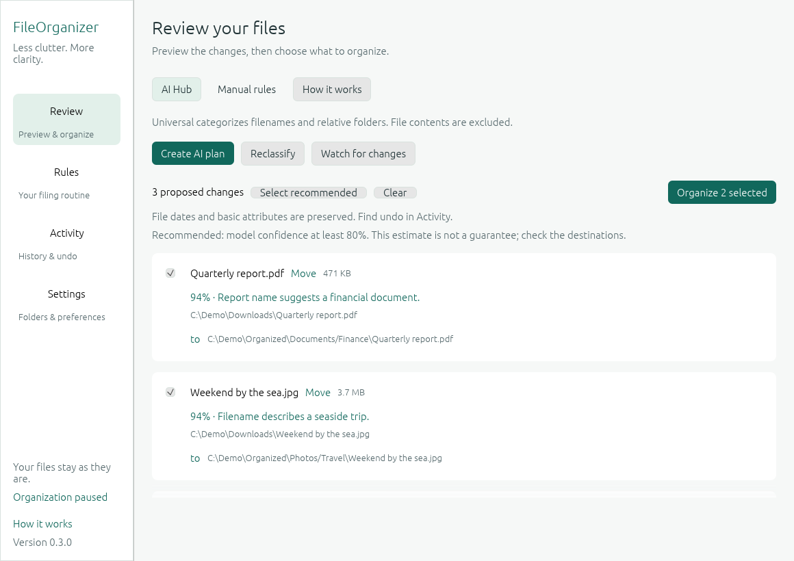

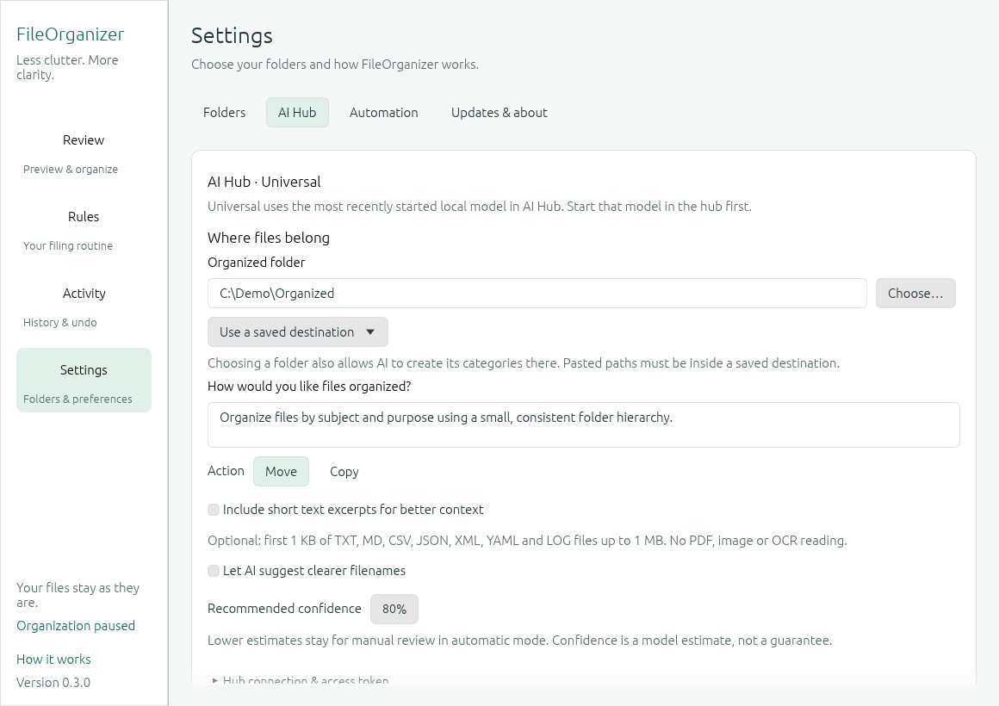

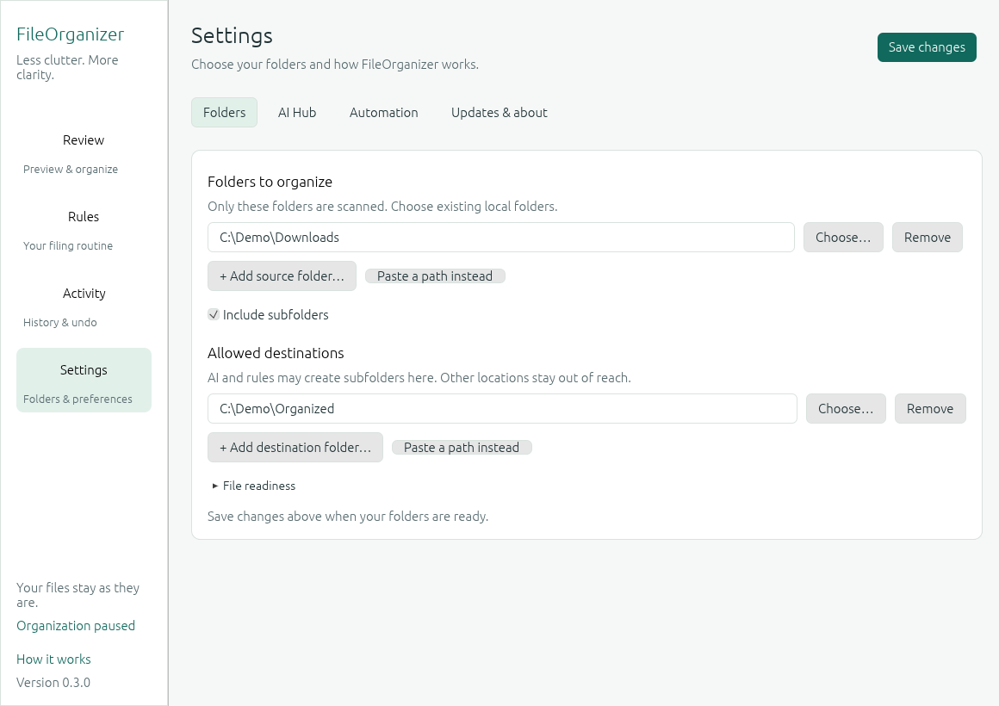

<details>
<summary>Manual review, rule editor, updates, automation, history, onboarding and recovery</summary>

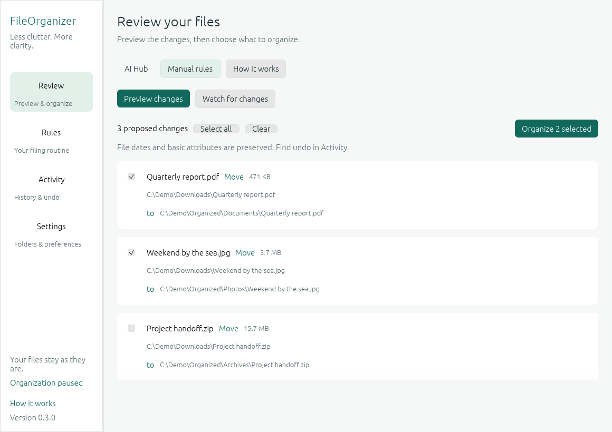

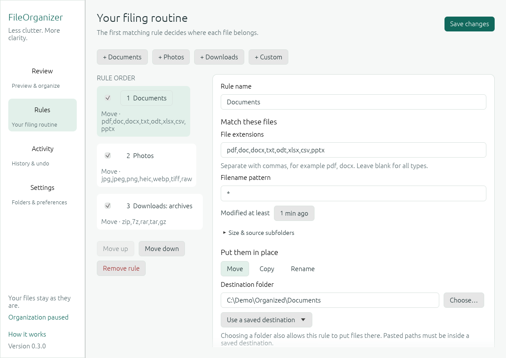

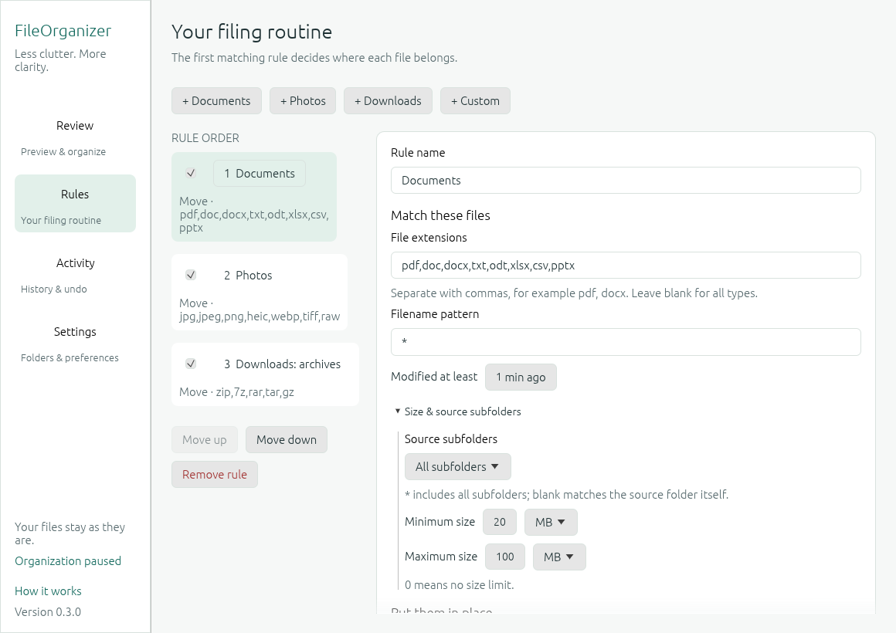

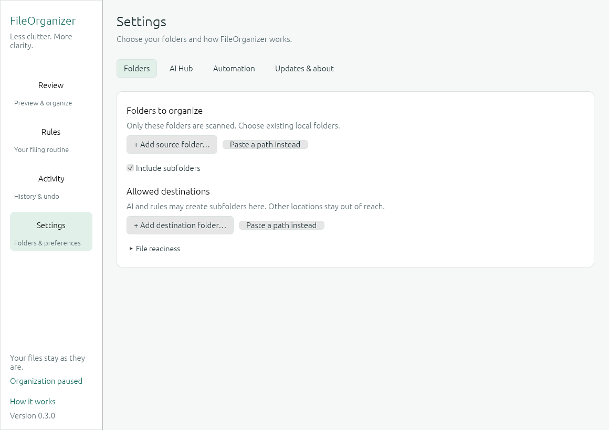

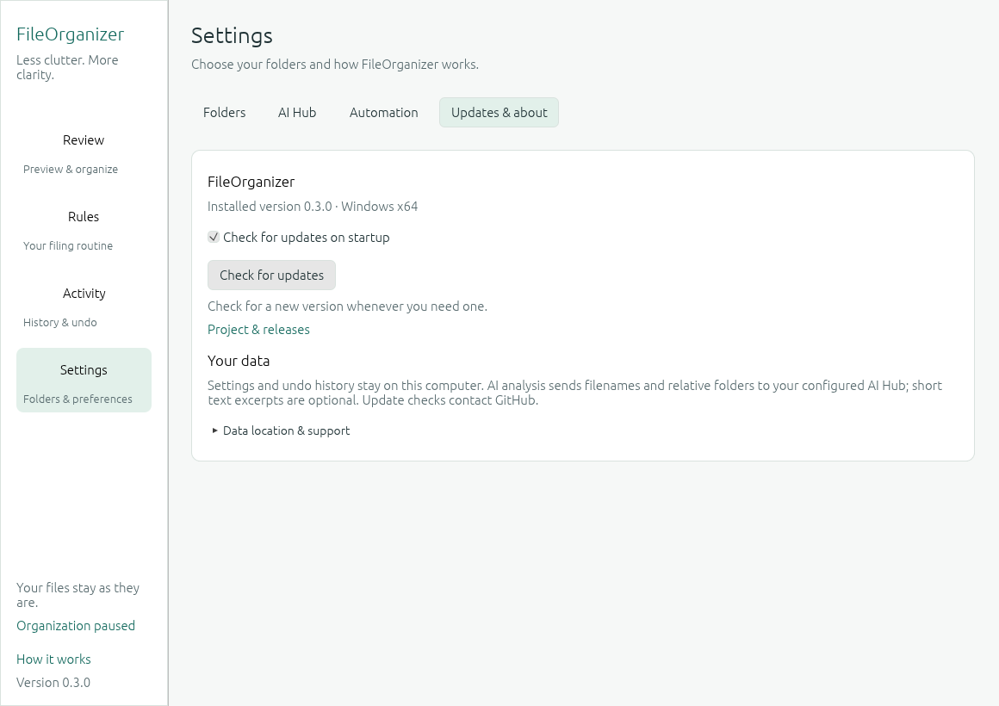

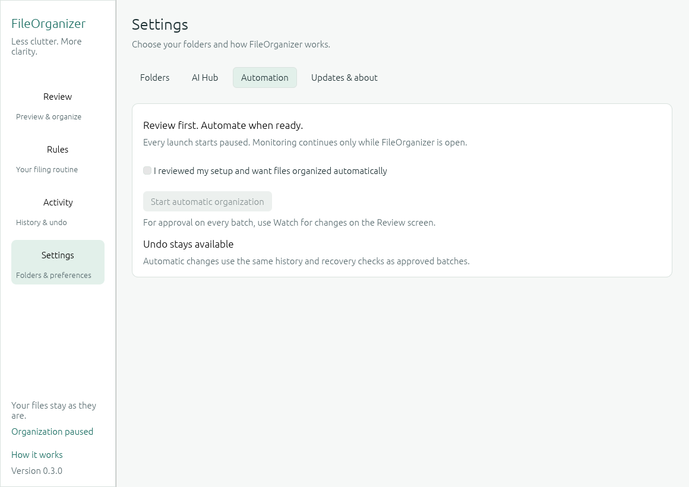

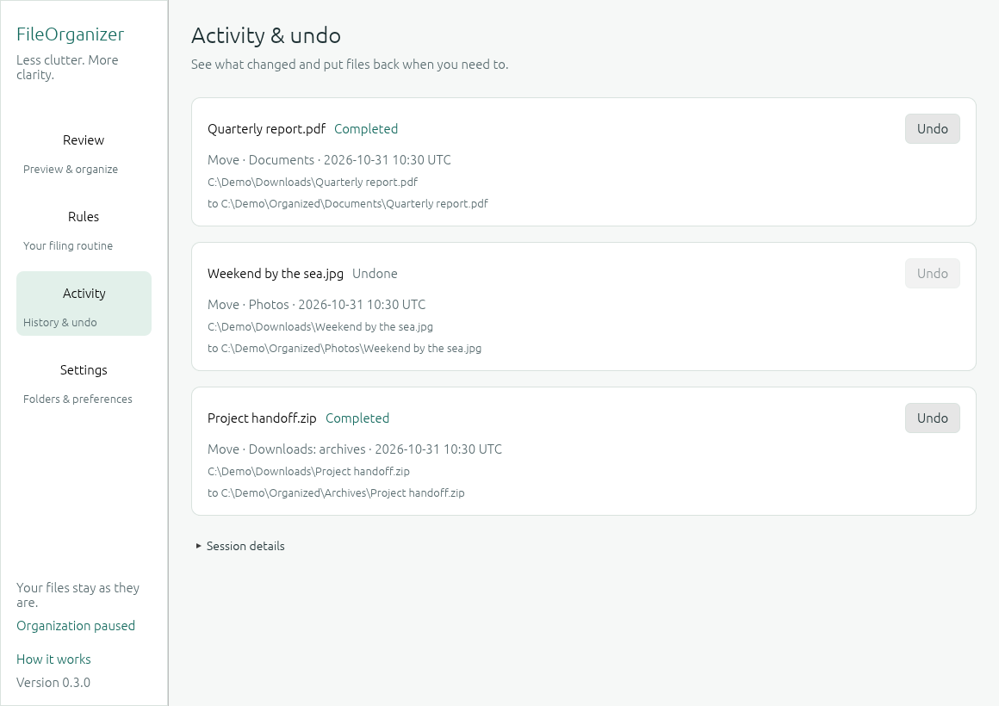

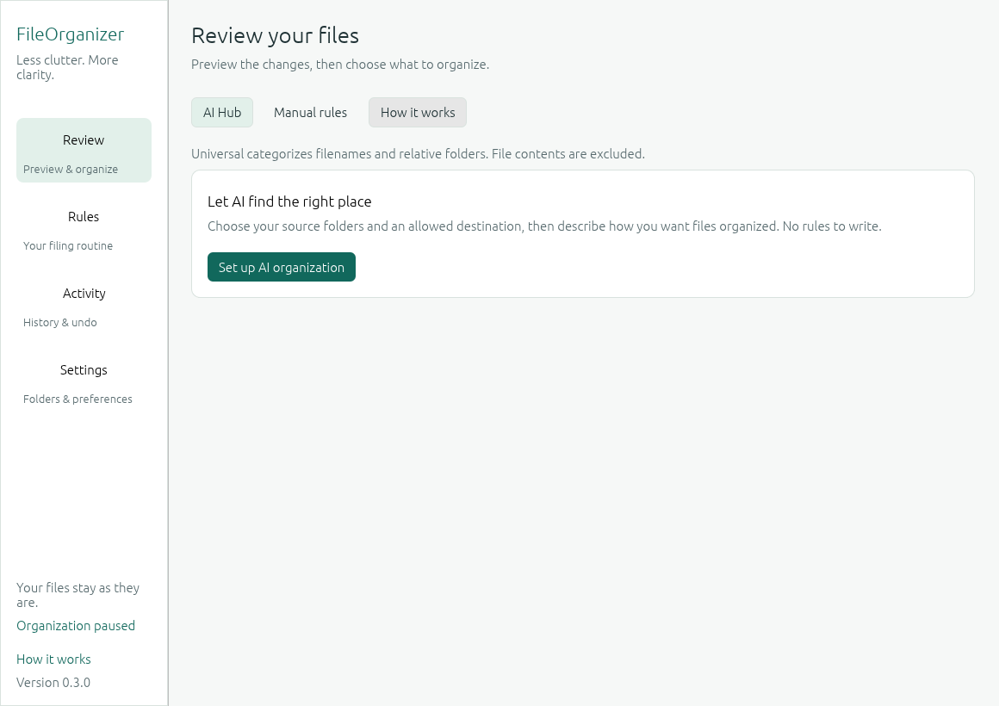

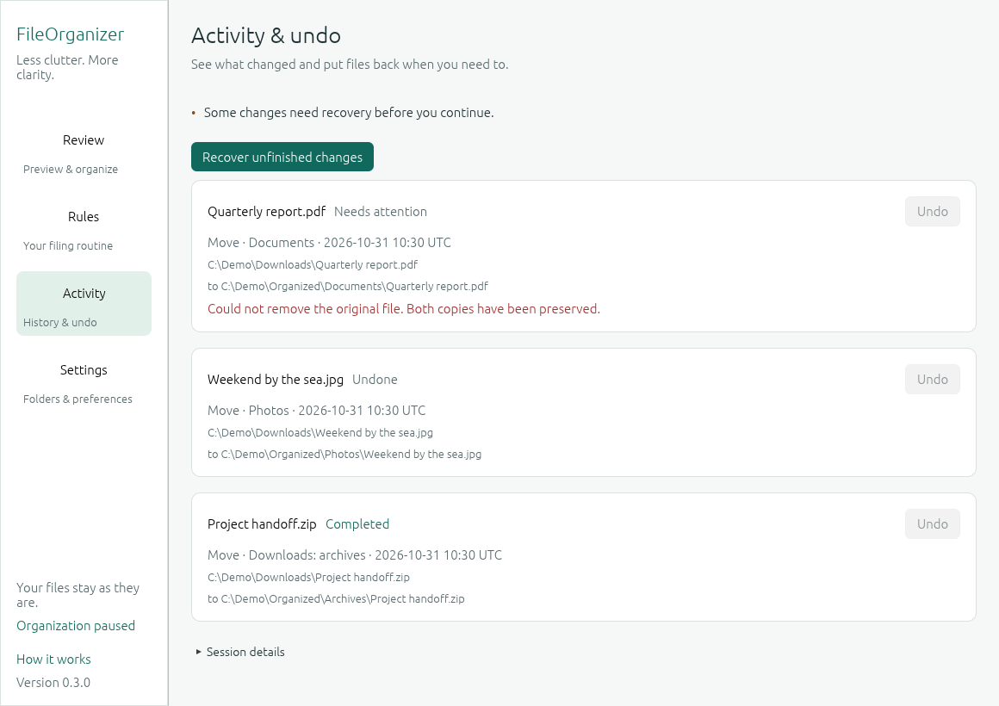

</details>

## Build and package

Use Rust 1.95 or newer with the Windows MSVC toolchain, existing Visual C++/Windows SDK tools (including rc.exe), and Python 3.11+ for packaging inspection. Manual-rule mode requires no AI service or account. AI mode connects to your running AI Hub and local model, using your hub token if required. No service, driver or browser runtime is installed. Dependencies are locked in `Cargo.lock`; SQLite and TLS support are bundled into the executable. The Windows x64 target uses the static CRT.

```powershell
cargo fmt --all --check
cargo clippy --locked --all-targets -- -D warnings
cargo test --locked --all-targets -- --test-threads=2
.\scripts\package.ps1
```

Cargo is limited to two jobs and uses this repository's `target` directory. Add `--offline` to Cargo commands when the dependencies are already cached. Packaging builds without launching the application and produces `dist/FileOrganizer-v0.3.0.exe` and `dist/SHA256SUMS.txt`. The executable name has no architecture suffix because the initial distribution targets one architecture, Windows x64. Source builds for other platforms are not a supported release target.

Optional static inspection with Python's standard library (no executable launch): `python scripts/inspect_executable.py dist/FileOrganizer-v0.3.0.exe`. The application itself does not require Python. The UI uses CPU rasterization and a Win32 GDI presentation path. Native presentation and desktop responsiveness await manual validation.

For a first manual run, launch the packaged executable yourself. Start with a disposable folder and keep independent backups before using important files.

## AI Hub organization

Choose source and allowed destination folders in **Settings → Folders**, then configure **Settings → AI Hub** with `http://127.0.0.1:8080/v1`, your hub token and an organized folder. Use **Choose…** for the organized folder or reuse a saved destination. Picking that folder also grants the exact output scope, so a separate approval-list visit is unnecessary. Start a local model in AI Hub. On **Review**, select **AI Hub → Create AI plan**. Describe the desired organization instead of creating rules. Review reasons/destinations and select proposals before applying, or explicitly enable confidence-gated automation.

`universal` routes to the most recently started running local model in your hub. It is not a separate model to download. Filename, relative subfolder and size are sent by default; optional short text excerpts are off by default. PDF/image/OCR analysis is not implemented. Cached decisions avoid repeat requests; **Reclassify** asks again after a model change. [Setup, data sharing, limits and verification](docs/AI_HUB.md). Live model integration remains unverified in this network-restricted development environment.

## Manual rules workflow

1. Open **Settings → Folders**. Use **Add source folder…** and **Add destination folder…** to open the Windows folder chooser. Existing rows have **Choose…** buttons, and **Paste a path instead** keeps manual entry available. No real folders are preselected. Local drive paths are supported; symbolic links, junctions/reparse points and network paths are refused.
2. Open **Rules**, add a template, then use **Choose…** or **Use a saved destination**. Templates suggest a subfolder of the first saved destination. Choosing a new destination adds that exact folder to the approved list; pasted paths must be inside a saved root. Missing subfolders can be created during application. For Rename, the destination stays in the original source folder.
3. Adjust conditions and the filename template. Conditions are ANDed. Extensions are comma separated, without a leading dot. `*` matches any characters, including separators in a subfolder condition; `?` matches one character. An empty subfolder pattern matches only the source root. Size controls offer bytes, KB, MB and GB (powers of 1024); age uses modification time in minutes. Common subfolder choices are available without writing a pattern. Types are detected by extension, not content or EXIF.
4. Choose **Preview changes**. The first observation waits for the settling interval (default 3 seconds); a background second observation refreshes the plan. Preview does not change source/output files. Saving settings and scanning can write only application metadata.
5. Select actions, then choose **Organize selected**. Each file is revalidated before execution. A late collision or changed source stops the batch and preserves the conflicting file. Generate a fresh preview to reconsider conflict names.
6. Use **Activity → Undo** to restore a completed move/rename or remove an unchanged copy. Undo does not overwrite an occupied original path. If an unfinished operation exists, **Recover unfinished changes** attempts a conservative rollback first.

**Watch for changes** keeps the plan updated without applying it. You can approve a selection directly while watching: the worker pauses monitoring and verifies that the reviewed plan is still current. **Pause monitoring** remains available separately. For unattended filing while the application is open, review the rules, tick the explicit automatic-organization acknowledgement under **Settings → Automation**, then choose **Start automatic organization**. Edits pause monitoring and invalidate the displayed plan. Changes show a **Save changes** button. Previewing also saves the current configuration. Settings are saved during orderly close. Closing waits for the current file to reach a journaled boundary and cancels remaining batch items; it does not leave a background service running.

## Safety and scope

Source and destination roots bound all operations. Output subtrees are excluded from input scanning; source roots wholly inside an output directory are rejected. Rename results and already processed file versions are recorded to prevent self-trigger loops. Undo does not immediately reapply the same file version. To intentionally reprocess an unchanged file, change its modification time/content or create a new source file; there is no destructive history reset button.

On Windows, source/output handles deny concurrent write/delete sharing while copying, hashing or removing a file. Open writers cause execution to fail safely. Data is copied to a uniquely named staging file beside the destination, flushed, verified, and published with Windows `MoveFileExW` **without** `REPLACE_EXISTING`. A move removes the original only after publication and a persisted journal phase. This also works across source/destination volumes. Undo uses the same staged publication rule. Filesystem ancestor components are checked for reparse points before traversal and again at execution boundaries.

Windows creation, last-access and last-write timestamps and the basic attributes Read-only, Hidden, System, Archive, Temporary and Not content indexed are preserved. A file with no attribute flags keeps that state. Handles used to read originals and undo outputs suppress access-time updates. The journal stores the original values before copying; move/rename undo and crash recovery restore that snapshot even if the output's metadata was edited later. Copy undo removes the copy and leaves later changes to the source intact. Read-only files are supported: the flag is cleared only when removing a verified file, with metadata restoration attempted if deletion fails. Metadata restoration failure stops the operation before deleting the last complete copy.

This is a desktop tool for trusted, user-owned local folders. It is not a security sandbox against a malicious process swapping directory ancestors during an operation. Filesystem/hardware flush guarantees still apply. Timestamp precision depends on the destination filesystem. NTFS change time, ACLs, ownership, alternate streams and extended attributes are not copied. Storage/cloud flags such as compression, encryption, sparse, offline or pinned state require separate mechanisms; sources carrying unsupported flags are rejected before content copying instead of silently dropping them. Attribute-write permission is required even for source copies so that access-time preservation is possible. There is no automatic deletion rule, PDF/image/OCR analysis, tray mode, autostart registration or service installation.

Scans are bounded to 10,000 eligible files, 2,000 directories and 30,000 directory entries; each plan has at most 2,000 actions. Output-name inspection is bounded to 30,000 entries. Activity displays the latest 500 records; the durable journal and processed-file fingerprints remain on disk. Choose narrower folders for larger collections. Native watcher errors pause organization; a 60-second reconciliation scan while monitoring covers age conditions and coalesced notifications. A missing/inaccessible folder stops or reports the scan rather than silently following another location.

## Recovery and local data

Settings and journal data live under `%LOCALAPPDATA%\FileOrganizer\organizer.db`, with SQLite WAL/SHM files and an instance lock. A second instance using the same data directory is refused. There is no telemetry. The database contains paths, rules, timestamps and file hashes; protect it as local personal data. AI mode sends filenames and relative folders to the configured hub, plus short text excerpts only when enabled. AI decisions and explanations are cached in the database. Tokens stay in Windows Credential Manager. Public update checks contact GitHub.

Unfinished records block new application until resolved. Recovery inspects recorded paths and hashes, restores a missing original if possible, then removes only matching output/staging files. Changed outputs, occupied restore paths with different content, missing files or partially written staging files are preserved and require manual inspection. See [recovery details](docs/ARCHITECTURE.md). Back up the entire data directory while the application is closed before making any manual database repair. There is intentionally no one-click way to discard an ambiguous journal record.

Journal records created before metadata preservation remain readable. They contain no original metadata snapshot, so their move/rename undo retains the metadata available on the output; lost historical timestamps/attributes cannot be reconstructed. New records restore the captured original values.

## Updates and future distribution

**Settings → Updates & about** shows the installed version, **Check for updates**, and the persistent **Check for updates on startup** toggle. Startup checks run in a separate worker and show no no-update or transient-error dialog. Disabling the toggle and saving prevents startup requests on the next launch; manual checking remains available. A missing/unpublished repository, offline connection or rate limit is reported as an unavailable check, not as “up to date.”

The stable updater compares semantic versions, rejects drafts/prereleases and selects the canonical `FileOrganizer-vVERSION.exe` asset. **Download and install** requires explicit user action and a paused organizer. It displays progress, checks published size, SHA-256 (GitHub asset digest or `SHA256SUMS.txt`) and Windows x64 PE headers, finishes file work, exits, replaces the executable through a copied headless helper, then restarts. Configuration/journal data remain in LocalAppData. The install directory must be writable without elevation. A failed download leaves the installation unchanged; replacement has a rollback backup. Helper failures are saved in `update-error.txt` for the next launch. Interrupted helpers may leave staging/backup files for inspection.

No release/network download or updater installation has been exercised in this development session. Before publishing, complete the [manual validation checklist](docs/VALIDATION.md) and use the [release notes draft](docs/RELEASE_NOTES_v0.3.0.md). Builds are not code-signed. SHA-256 verifies integrity against release metadata; it is not a publisher signature.

## Development

New delivered binaries advance the package version: patch for fixes, minor for added capabilities. Use `python scripts/bump_version.py patch` (or `minor`), then update release notes. Commits remain independent of release numbering. Packaging verifies the embedded icon and Windows file/product versions, and refuses changed bytes under an existing version. See [versioned builds](docs/VERSIONING.md).

The pure planner is separated from filesystem inspection, journal execution, watcher scheduling and GUI code. One bounded background worker serializes filesystem work; a cancellable single-flight AI job performs classification, and a separate worker serializes update requests. The GUI wakes for input or results and does not scan folders or hash files in paint callbacks. See [architecture](docs/ARCHITECTURE.md) and [validation record](docs/VALIDATION.md).

License: [MIT](LICENSE).

## Static visual review without computer use

The developer-only mode `FileOrganizer-v0.3.0.exe --capture ABSOLUTE_OUTPUT_DIRECTORY [WIDTH HEIGHT [SCALE]]` renders nineteen actual screen fixtures through the same UI and CPU renderer as normal operation, writes PNGs plus `capture.json`, and exits. Use a fresh directory; existing files are never overwritten. The mode is parsed before normal startup: no window, file worker, update worker, database, filesystem watch or network request is started. Examples: default 1160 × 820; `960 680` for the minimum layout; `1200 850 1.25` for a 125% capture with a 960 × 680 logical client area. It has a 20-second internal batch deadline and three frames per screen; run it with a 30-second external process timeout.

The normal desktop host uses `Wait`/`WaitUntil`, discards stale repaint requests, and keeps hidden/minimized data changes dirty for restoration without rendering them. An optional `--render-log ABSOLUTE_JSON_PATH` writes frame/wakeup counts and layout/raster/present totals after an ordinary run exits. This diagnostic is outside consumer settings. It is preparation for native measurement, not proof of settled idle behavior. See [design and rendering review](docs/DESIGN_REVIEW.md).
